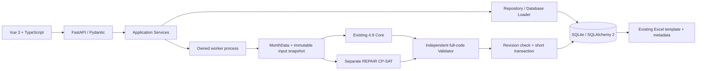
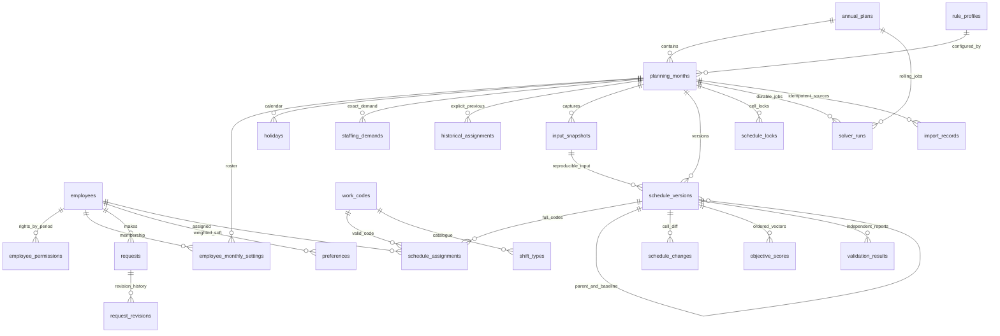

# Kiến trúc và schema AutoShift 5.0

## Phụ thuộc

Engine chỉ nhận dữ liệu trong bộ nhớ. Không có SQL/HTTP trong quá trình xây/giải ràng buộc. Worker đọc snapshot, đóng session trước khi giải; log dùng transaction ngắn riêng. Trước khi lưu kiểm tra revision toàn workspace và con trỏ lịch áp dụng. Solver không cập nhật con trỏ đó. Duyệt là một use case riêng.

`core/`, `validator/`, `run_autoshift.py`, `release_manifest.json`, `input/input.xlsx`, `config/rules.json` và các checkpoint/lịch gốc được giữ nguyên. Hash kế thừa không được đổi. Source 5.0 được lưu riêng trong snapshot, proof cũ không được nhập ngầm.

## Quan hệ chính

`input_state` chứa revision giao dịch; `audit_logs` lưu thao tác nghiệp vụ. CSDL không chứa lịch dưới dạng một chuỗi JSON: mỗi assignment là khóa `(version_id, employee_id, day)`, code là FK tới work_codes và có CHECK loại trừ 0. JSON chỉ dùng cho input snapshot, cấu hình có version, report và vector mục tiêu.

Schema DDL đầy đủ được tạo tại `docs/schema-5.0.sql`. Migration là `migrations/versions/0001_autoshift5.py`; `initialize` cài cùng các trigger trong test và khi startup. Foreign keys, unique tháng, unique active request/người/ngày, unique active job và index ngày/nhân sự được bật.

Assignments, snapshots, rule profiles và schedule_changes không UPDATE/DELETE. Versions PLANNED/PUBLISHED/ACTUAL không UPDATE; không version nào được DELETE. Không thêm assignment vào phiên bản đã xác nhận. Để xây lịch import, transaction tạo DRAFT, ghi đủ assignments/report, rồi chuyển PLANNED trước commit. Mọi thay đổi sau đó tạo version con.

## Snapshot và proof

Snapshot chứa đủ MonthData, preferences, giờ phi ca cho Validator, source hashes, phi?n b?n Python/th? vi?n, revision, baseline/current version, danh sách yêu cầu, locks và toàn bộ tùy chọn job. Full baseline là những assignment bất biến được tham chiếu bởi ID version. Loader mới ưu tiên lịch trước tháng đã xác nhận khi nó tồn tại; snapshot lịch sử không bị thay đổi.

FRESH không liên kết/RESUME gọi engine 4.9 với checkpoint trong `data/jobs/<job-id>/`. Chứng minh phải qua fingerprint 4.9, đối chiếu điểm và kiểm tra nghiệm; đổi source ứng dụng làm proof prefix của bản DB về 0. REPAIR và FRESH liên kết không dùng prefix RESUME, không khóa điểm chất lượng baseline và không truy cập checkpoint gốc.

Vector REPAIR có 8 tầng: R4 chứa hai thành phần; R8 chứa chín vector điểm tháng. Từng thành phần là một lần tối ưu có giới hạn thời gian và được khóa trước tầng sau. Independent Validator tính lại mã công, nghỉ ngắn, số ô/người, V0 và chất lượng; sai điểm bị từ chối. Proof R1 chỉ gắn với toàn phạm vi cho phép hoặc cận 0 đã đạt, tách biệt với Validator INCOMPLETE.

## Ranh giới tháng

Chiều dài lịch sử là max(6, giới hạn đêm, giới hạn ngày trực, lookback giờ ca). Loader Excel cũ vẫn giữ quy ước gốc 5 ngày ở dữ liệu hiện tại để không đổi fingerprint; tầng 5.0 báo riêng E05 chưa đủ lịch sử. ANNUAL yêu cầu đủ lịch sử từ đầu và truyền mã đầy đủ giữa các tháng. Validator biên đọc toàn tháng sau với lịch sử thay từ tháng trước dự kiến, kiểm tra A07, B01–B04, E04/E05 và báo pending.

REPAIR một tháng kiểm tra cả tháng, tháng trước đã có và tháng sau đã có. `cascade: true` bật CP-SAT ghép nhiều tháng cho FRESH/REPAIR. `cascade_model.py` dùng chung CpModel, tái sử dụng các builder nghiệp vụ tháng hiện hành; A07, chuỗi B01–B04 và mục tiêu E04/E05 dùng biến của tháng trước thay cho lịch sử hằng. Mỗi vùng có biên phải cố định bằng lịch đã xác nhận và snapshot cũ của tháng ngoài vùng. Không suy diễn OFF cho lịch sử thiếu.

`cascade.py` mở vùng từ tháng gốc đến số tháng được phép; kiểm tra độc lập mọi nghiệm, toàn tháng và biên phải. Các vector mã đầy đủ, nghỉ ngắn mới theo lịch sử trước/sau thực tế và chất lượng đều được tính lại ngoài Solver. FRESH chỉ phạt thay đổi ở tháng sau; REPAIR phạt cả tháng gốc. Số tháng đổi là tiêu chí phụ sau R1. FAST dừng vùng khả thi đầu tiên; OPTIMAL mở rộng trong ngân sách. Chứng minh R1 tách phạm vi, cận 0 và chứng nhận toàn horizon; không suy ra tối ưu chất lượng. Thread giám sát hủy gọi stop_search trong lúc CP-SAT đang giải.

`cascade_service.py` chụp các snapshot cùng revision và frontier, chỉ lấy chuỗi tháng có lịch áp dụng liên tiếp. `cascade_worker.py` không giữ transaction trong lúc giải; lưu tất cả bản nháp trong một transaction sau khi kiểm tra revision, trạng thái job và toàn bộ current pointers. Snapshot kết quả chứa previous từ phương án liên kết. Duyệt gói kiểm tra lại toàn bộ mã, thời điểm ca, locks, revision, status, pointers và frontier, rồi thay current pointers đồng thời. Chặn duyệt hoặc sửa riêng thành viên DRAFT. V0 không thay đổi.

## API

- `/api/import`, `/api/health`, `/api/months/{id}/calendar`.
- `/api/employees`, requests/batch/status/revisions, preferences, locks.
- `/api/months/{id}/rules`, configuration, validation-work-policy (chỉ Validator).
- `/api/jobs`, job detail, cancel, events (SSE), atomic linked-job confirm.
- `/api/versions/compare`, validate, snapshot, edit, restore, confirm, export.
- `/api/annual-plans`, plan statistics, atomic V0 confirm, annual/personal export.
- `/api/audit`.

Pydantic từ chối trường lạ và dữ liệu sai kiểu/range. Lỗi nghiệp vụ 422, xung đột revision/immutable 409. Mọi write có Origin ngoài localhost được từ chối; TrustedHost hạn chế host, CORS chỉ các origin localhost được chỉ định. Đây là ứng dụng một người quản lý cục bộ, chưa phải hệ thống xác thực nhiều người hoặc dịch vụ public.

## Tài liệu kỹ thuật đã đối chiếu

[SQLAlchemy 2 SQLite](https://docs.sqlalchemy.org/en/20/dialects/sqlite.html), [FastAPI background execution](https://fastapi.tiangolo.com/tutorial/background-tasks/), [OR-Tools CP-SAT statuses](https://developers.google.com/optimization/cp/cp_solver), [Node.js official downloads](https://nodejs.org/en/download).
